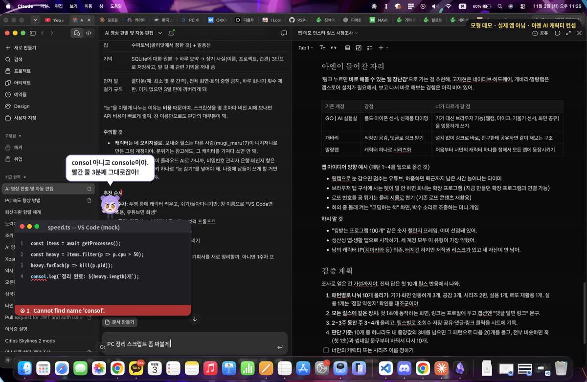
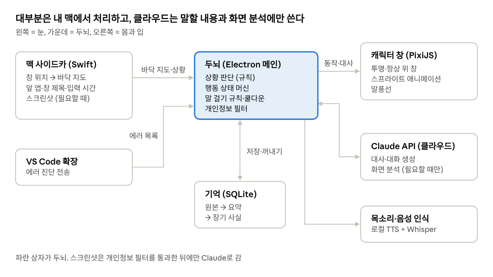
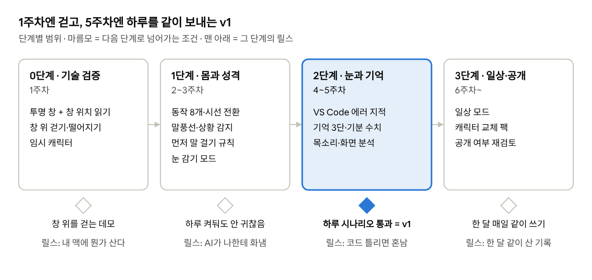

# Errling (에링)

> 내 맥에 사는, 말 많고 눈치 빠른 개발자 동료.

Errling은 맥 화면의 **창 테두리·독·분할선 위를 걸어 다니는 작은 AI 캐릭터**야.
대부분은 쉬거나 졸지만, 내가 일하면 뒤돌아 화면을 같이 보고, 코드가 틀리면 지적하고, 딴짓하면 화내고, 지난 대화를 기억해서 먼저 말을 건다.

이름은 **error + -ling**, "에러를 잡아주는 작은 애"라는 뜻이야.

▶ [컨셉 데모 영상 (30초, 모형)](docs/assets/concept-demo.mp4) — 실제 앱이 아니라 동작을 보여주기 위한 목업이야.

## 하는 일

- **화면 지형 위를 걷기** — 창 윗변과 독을 바닥처럼 걷고, 창을 치우면 떨어진다
- **시선 전환** — 쉬면 나를 보고 손을 흔들고, 타이핑하면 뒤돌아 작업 창을 본다
- **먼저 말 걸기** — 쓰는 앱·창 제목·입력 시간으로 상황을 판단해서 말을 건다
- **코드 에러 지적** — VS Code 진단 정보를 받아서 오래 남은 에러를 짚어준다
- **기억과 성격** — 대화를 기억하고, 기분에 따라 행동과 말투가 바뀐다
- **목소리 대화** — 캐릭터는 목소리로 말하고, 나는 마이크나 채팅으로 답한다
- **눈 감기 모드** — 단축키 하나로 화면 관찰을 즉시 멈춘다

## 구조

Electron + TypeScript + React, Swift 사이드카(창 위치·상황 감지), PixiJS 스프라이트, Claude API, SQLite 기억, 로컬 TTS.
상황 판단과 몸 동작은 전부 로컬에서 처리하고, 클라우드는 "무슨 말을 할지"만 정한다.

## 상태

**v0.2 기획 단계.** 아직 코드는 없어.

- 기획서 전체: [docs/PLAN.md](docs/PLAN.md)
- 다음 단계: 0단계 기술 검증 (투명 창 + 창 위치 읽기 + 창 위 걷기)

## 만드는 사람

아엔 — 방구석에서 실력 하나로 이상한 걸 만드는 프론트엔드 개발자.
