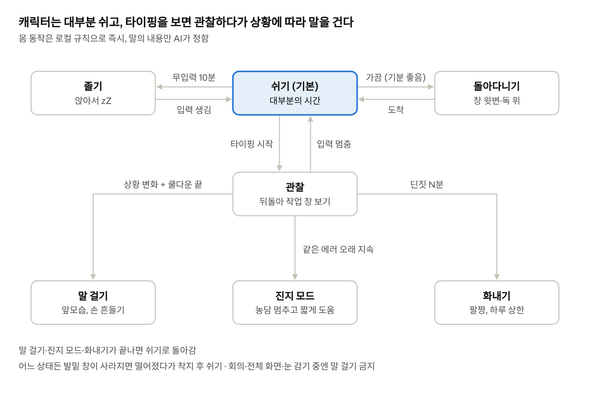
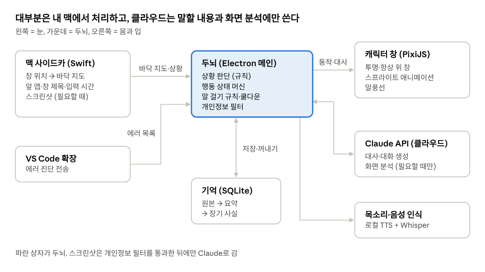
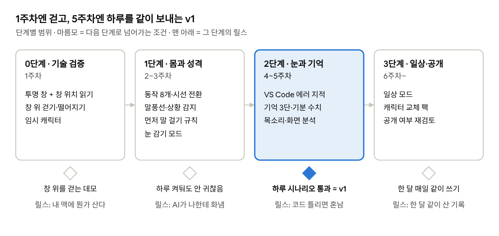

# Errling(에링) 기획서 v0.2

2026-11-04 · 아엔

## 1. 개요

**한 줄 정의**: 맥 화면의 창 테두리·독·분할선 위를 걸어 다니며, 내가 하는 일을 보고 먼저 말을 거는, 성격과 기억이 있는 작은 서브컬처 AI 캐릭터.

이 문서는 v0.2야. v0.1의 미결정 질문 6개 중 4개에 답을 반영했고, 남은 건 12장에 정리했어. 앱 이름은 Errling(에링)으로 정했어. error + -ling, '에러를 잡아주는 작은 애'라는 뜻이야. 골리앗과는 별개 앱이고, 당분간 나 혼자 쓰는 도구야.

**배경**
- 골리앗(자비스)은 "목소리로 뭐든 시키는 비서"였어. 기능은 강하지만 보이지 않는 존재라 정이 붙기 어렵고, 내가 불러야만 움직였어.
- 이번엔 반대로 간다. **눈에 보이고, 먼저 다가오고, 나를 기억하는 존재.** 비서가 아니라 화면 속에 같이 사는 동료에 가깝게.
- 기존 데스크톱 마스코트(시메지)는 화면을 돌아다니기만 하고, 최근 AI 컴패니언 앱들은 똑똑하지만 정해진 자리에 서 있어. 둘을 합친 게 이 제품이야.

**목표**
1. **제품 목표**: 하루 종일 켜둬도 귀찮지 않고, 꺼지면 허전한 캐릭터.
2. **브랜딩 목표**: 만드는 과정 자체를 인스타 릴스 시리즈로 공개해서 '방구석 토니 스타크' 개발자로 알려지기.
3. **기술 목표**: 골리앗에서 정한 Electron·Claude·로컬 음성 구조를 재사용해서, 3주 안에 걸어 다니고 말 거는 첫 버전, 5주 안에 하루를 같이 보내는 v1 완성.

**하지 않을 것 (v1 범위 밖)**
- 내 컴퓨터를 대신 조작하기 (클릭, 타이핑 대행)
- 윈도우 지원 (v1은 맥 전용)
- 여러 캐릭터 동시 실행, 캐릭터 마켓

## 2. 문제 정의와 타깃 사용자

**해결하려는 문제**
- 혼자 일하면 집중이 쉽게 깨지고, 딴짓을 해도 아무도 모른다.
- 에러나 실수를 혼자 붙잡고 오래 헤맨다. 누가 옆에서 "그거 오타잖아" 한마디만 해줘도 끝날 일인데.
- 기존 AI는 내가 질문해야만 대답한다. 먼저 알아채고 말 걸어주는 존재가 없다.
- 생산성 앱은 기능만 있고 감정이 없어서, 며칠 쓰다 꺼버린다.

**핵심 가설**: 귀엽고 성격 있는 캐릭터가 "보고 있다"는 느낌을 주면, 사람은 그 캐릭터 때문에 조금 더 집중하고 오래 켜둔다.

| 페르소나 | 상황 | 원하는 것 | 캐릭터가 해주는 것 |
| --- | --- | --- | --- |
| 1차: 혼자 코딩하는 개발자 (아엔 본인) | 새벽까지 사이드 프로젝트, 막히면 유튜브로 도망 | 집중 유지, 빠른 실수 발견, 외롭지 않기 | 에러 지적, 딴짓 경고, 커밋 칭찬, 막혔을 때 진지한 도움 |
| 2차: 재택·프리랜서 직장인 | 메일·문서·회의가 섞인 하루 | 할 일 리마인드, 쉬는 시간 관리 | "메일 세 번째 다시 쓰는 중이네", 휴식 권유, 일정 상기 |
| 3차: 서브컬처 좋아하는 학생·게이머 | 공부와 게임 사이 | 같이 있는 느낌, 귀여움 | 공부 타이머, 게임 중엔 조용히 응원, 기억해주는 대화 |

v1은 **1차 페르소나 하나에 집중**해. 내가 매일 쓰면서 고치는 게 가장 빠른 검증이야. 2·3차는 '일상 모드'로 v2에서 넓혀.

## 3. 시장·경쟁 분석과 차별점

"화면을 보는 AI 캐릭터" 자체는 이미 여러 곳이 만들고 있어. 차별점은 **어디서 움직이느냐**와 **무엇을 보고 말하느냐**에서 나와야 해.

| 제품 | 형태 | 화면 이해 | 먼저 말 걸기 | 기억 | 가격 | 우리와 다른 점 |
| --- | --- | --- | --- | --- | --- | --- |
| [Shijima (시메지)](https://pixelomer.itch.io/shijima) | 창 위를 걷는 2D 마스코트, 오픈소스(GPLv3) | 없음 | 없음 | 없음 | 무료 | 움직임은 같지만 AI가 없음 |
| [Kizuna Desktop](https://heroworks.itch.io/kizuna-desktop) | 3D VRM 캐릭터, 윈도우 전용, 베타 | 있음 (선택) | 있음 | 관계 성장 | 미공개 | 정해진 자리의 3D 아바타, 화면 지형을 걷지 않음 |
| [AIvy](https://store.steampowered.com/app/4753040) | 3D VRM 데스크톱 마스코트 | 쓰는 앱 종류 인식 | 있음 | 장기 기억 | $14.99 | 앱 종류만 알고 내용(코드 에러)까지는 안 봄 |
| [Razer Project AVA](https://80.lv/articles/razer-unveils-3d-hologram-ai-companion-project-ava) | 책상 위 홀로그램 하드웨어 | 있음 | 대화형 | 언급 없음 | 미정, 2026 하반기 | 별도 기기 필요, 게이밍 중심 |

**우리 차별점 세 가지**
1. **화면 지형 위의 몸**: 창 윗변, 독, 분할선을 실제 바닥처럼 걷고, 창을 옮기면 떨어진다. 캐릭터가 "내 화면에 산다"는 느낌은 이게 만든다.
2. **내용을 읽는 눈**: 앱 이름이 아니라 실제 코드 에러, 반복되는 행동을 알아챈다. VS Code 진단 정보를 직접 받아서 정확하다.
3. **고정된 성격**: 청명처럼 투덜대고 자신만만하다가 진짜 막히면 진지해지는 캐릭터. 친절한 비서가 아니라 성격 있는 동료.

**포지셔닝 한 줄**: "내 맥에 사는, 말 많고 눈치 빠른 개발자 동료."

## 4. 캐릭터 설정

캐릭터가 이 제품의 전부야. 기능은 따라 만들 수 있어도 성격은 못 따라 해.

**콘셉트**: 화면 속에 사는 작은 서브컬처 미소녀. 겉으로는 투덜대고 자신만만하지만, 주인(사용자)이 진짜 힘들 땐 제일 먼저 진지해진다. 모티프는 화산귀환 청명의 "평소엔 건방지고 웃기지만 싸울 땐 진심"인 온도차.

| 항목 | 설정 |
| --- | --- |
| 외형 방향 | 2~3등신 치비, 화면에서 약 80~100px 높이. 앞·뒤·옆 세 방향 스프라이트 |
| 기본 성격 | 자신만만, 장난기, 투덜거림. 칭찬엔 약해서 쑥스러워함 |
| 진지 모드 | 에러가 오래 안 풀리거나 사용자가 지쳐 보일 때. 농담을 멈추고 짧고 정확하게 도움 |
| 말투 | 반말, 짧은 문장, 한 말풍선은 한 호흡. 사과하지 않음. "망했네. 다시 해." |
| 금지 | 비하·모욕, 사용자 외모·사생활 언급, 하루 화내기 횟수 초과, 업무 중 긴 수다 |
| 관계 | 처음엔 낯가리는 반말 → 함께한 날이 쌓일수록 기억을 꺼내 말하고 농담이 늘어남 |

**기분 시스템**: 캐릭터는 0~100의 기분 수치를 가져. 칭찬, 커밋, 휴식 권유를 받아들이면 오르고, 딴짓이 길거나 무시당하면 내려가. 기분에 따라 쉬는 시간 비율, 말투 온도, 화내는 빈도가 바뀌어서 "살아 있다"는 느낌을 만들어.

**대사 예시**
- 첫 인사: "어, 왔어? 오늘은 뭐 만들 건데."
- 에러 지적: "consol 아니고 console. 빨간 줄 3분째야."
- 딴짓: "유튜브 20분째. 나 지금 화난 거 맞아."
- 진지 모드: "…잠깐. 이건 오타 문제가 아니야. 같이 보자."
- 칭찬: "커밋했네. …뭐, 나쁘지 않아."
- 기억: "어제 그 CORS 에러, 결국 프록시로 풀었잖아. 이번에도 그거 아냐?"

**외형 원칙**: AI로 직접 디자인해. 먼저 기준 이미지 한 장(정면 전신)을 확정하고, 그 이미지를 참조로 넣어 앞·옆·뒤 3면도와 표정 시트를 만든 뒤, 이 세트를 모든 생성의 기준으로 고정해. 레퍼런스 계정들은 분위기 참고만, 캐릭터는 오리지널.

## 5. 핵심 기능과 우선순위

P0는 없으면 이 제품이 아닌 것, P1은 v1 안에 넣을 것, P2는 반응 보고 넣을 것이야.

| ID | 기능 | 설명 | 완료 기준 | 우선순위 |
| --- | --- | --- | --- | --- |
| F1 | 화면 지형 걷기 | 창 윗변·독 윗선·화면 바닥을 '바닥'으로 인식해 걷고 점프 | 창을 옮기면 바닥이 따라가고, 창을 치우면 떨어져 다른 바닥에 착지 | P0 |
| F2 | 기본 동작 세트 | 걷기, 서기, 앉기, 졸기, 손 흔들기, 뒤돌기, 화내기, 떨어지기 | 각 동작이 앞·뒤·옆 방향에서 끊김 없이 전환 | P0 |
| F3 | 시선 전환 | 입력이 멈추면 나를 보고, 입력이 시작되면 뒤돌아 작업 창 쪽을 봄 | 타이핑 시작 1초 안에 뒷모습 전환 | P0 |
| F4 | 말풍선 대화 | 캐릭터 클릭 또는 단축키로 채팅, 말풍선으로 답 | 3초 안에 첫 답 표시 | P0 |
| F5 | 상황 감지 (싼 신호) | 활성 앱·창 제목·입력 없는 시간으로 '코딩 / 딴짓 / 쉬는 중 / 회의' 판단 | 상태 판단이 하루 사용 중 체감상 틀리지 않음 | P0 |
| F6 | 먼저 말 걸기 | 상황 변화에 맞춰 캐릭터가 먼저 말함. 초기값은 '자주'. 쿨다운·금지 시간 규칙 포함 | 회의·전체 화면 중엔 절대 말 안 함 | P0 |
| F7 | 코드 에러 지적 | VS Code 확장이 실제 진단 정보를 보내고, 오래 남은 에러를 지적 | 같은 에러 N분 이상 지속 시 지적, 수정되면 칭찬 | P1 |
| F8 | 기억 | 대화·사건을 저장하고 요약해서 나중에 꺼내 말함 | 하루 지난 일을 자연스럽게 언급 | P1 |
| F9 | 성격·기분 | 기분 수치에 따라 행동 비율·말투가 바뀜 | 같은 상황에서도 기분 따라 다른 대사 | P1 |
| F10 | 캐릭터 목소리 | 모든 대사를 목소리로도 말함. 끌 수 있음 | 말풍선과 음성 시작이 거의 동시 | P0 |
| F11 | 화면 이해 (비싼 신호) | 필요할 때만 스크린샷을 비전 AI로 분석 | 하루 호출 상한 안에서 동작 | P1 |
| F12 | 눈 감기 모드 | 단축키 하나로 화면 관찰 즉시 중단, 캐릭터가 눈 가림 | 누르는 즉시 캡처·분석 중단 | P0 |
| F13 | 설정 | 말 걸기 빈도, 화내기 허용, 목소리, 제외 앱 목록 | 메뉴 막대에서 바로 조정 | P1 |
| F14 | 외형 바리에이션 | 같은 캐릭터의 표정·옷 세트를 상황·계절에 따라 교체 | 팩 폴더만 바꾸면 옷·표정이 바뀜 | P2 |
| F15 | 일상 모드 | 메일·문서·일정 맥락의 말 걸기, 캘린더 연동 | 2차 페르소나 시나리오 통과 | P2 |
| F16 | 음성 대화 | 마이크로 말하면 캐릭터가 목소리로 답함 (골리앗 음성 인식 재사용) | 단축키 누르고 말하면 3초 안에 음성 답 | P1 |
| F17 | 화남 연출 | 화나면 얼굴이 빨개지고, 작업 창 테두리를 발로 툭툭 차거나 두드림 | 창이 실제로 살짝 흔들리는 연출 + 빨개진 표정 | P1 |

## 6. 행동 설계

캐릭터의 움직임은 상태 머신으로 설계해. 핵심은 **대부분 쉬고, 가끔 움직이고, 드물게 말한다**는 비율이야.

타이핑을 감지하면 즉시 뒤돌아 관찰하고, 관찰 중에 상황이 바뀌면 세 가지 말 걸기 중 하나로 간 뒤 다시 쉬기로 돌아와. 구체적인 시간값(10분, N분, 쿨다운)은 실사용 후 설정값으로 조정해.

**기본 시간 비율 목표**: 쉬기·졸기 약 65%, 관찰 약 20%, 돌아다니기 약 10%, 말 걸기·화내기 약 5% (초기값은 '자주 말 걸기', 귀찮으면 설정에서 낮춤). 기분 수치가 높으면 돌아다니기가 늘고, 낮으면 졸기가 늘어.

## 7. 사용자 시나리오: 아엔의 하루

| 시각 | 상황 | 캐릭터 행동 | 관련 기능 |
| --- | --- | --- | --- |
| 10:00 | 맥을 켬 | 독 위에서 기지개 켜고 "어, 왔어? 어제 그 로그인 버그 오늘 잡을 거지?" | F2, F8 |
| 10:15 | VS Code에서 코딩 시작 | 뒤돌아 작업 창 쪽을 보고 창 윗변으로 올라가 앉음. 조용히 구경 | F1, F3, F5 |
| 11:02 | 같은 타입 에러가 6분째 그대로 | 앞으로 돌아서 "그 any 하나 때문에 6분째야. 타입 좁혀." | F7 |
| 11:05 | 고치고 커밋 | 박수 치고 "…나쁘지 않네." 기분 +5 | F7, F9 |
| 13:30 | 유튜브 25분째 | 브라우저 창 위로 걸어와 팔짱. "점심시간 끝난 지 30분." 기분 −10 | F5, F6, F9 |
| 14:00 | 화상 회의 시작 | 구석으로 가서 조용히 앉음. 말 걸기 금지 | F6 |
| 16:40 | 3시간 연속 작업 | 손 흔들며 "물 마셔. 5분만." | F6, F9 |
| 17:00 | 은행 사이트 열기 | 자동으로 눈 가리고 관찰 중단 | F12, F13 |
| 23:30 | 사이드 프로젝트 마무리 | "오늘 커밋 7개. 내일은 테스트 짜는 거다?" 하루 요약 저장 | F8 |

이 시나리오가 **v1 인수 테스트**야. 내가 실제로 하루를 보내면서 표의 각 줄이 자연스럽게 일어나면 v1 완료로 봐.

## 8. 시스템 구조

구성은 **눈 → 두뇌 → 몸과 입**의 한 방향 흐름이야. 상황 판단과 행동은 전부 로컬에서 일어나고, 클라우드는 "무슨 말을 할지"와 "애매한 화면이 뭔지"만 답해.

두뇌의 개인정보 필터가 제외 앱·눈 감기 상태를 맨 앞에서 거르기 때문에, 필터를 거치지 않은 화면은 어떤 경로로도 밖에 나가지 않아.

## 9. 기술 스택과 핵심 결정

골리앗에서 정한 **Electron + TypeScript + React, 사이드카 프로세스, Claude API** 구조를 그대로 이어받아. 새로 생기는 건 '몸(캐릭터 렌더링)'과 '눈(화면 지형·상황 감지)'이야.

| 영역 | 선택 | 이유 |
| --- | --- | --- |
| 앱 껍데기 | Electron + TypeScript + React | 골리앗과 동일. 투명·항상 위 창을 만들 수 있고 제일 빠른 스택 |
| 캐릭터 창 | 화면 전체 크기 투명 창, 캐릭터 영역만 클릭 받고 나머지는 뒤로 통과 | 캐릭터가 화면 어디든 갈 수 있어야 해서 |
| 렌더링 | PixiJS 스프라이트 시트 (v1), Live2D는 v2 검토 | 2D 프레임 애니메이션이 가볍고, 캐릭터 교체(팩)가 쉬움 |
| 화면 지형 | Swift 사이드카: 창 목록·위치를 읽어 '바닥 지도'를 만들어 주기적으로 전달 | 맥 네이티브 API가 필요. 애플은 창 목록에 ScreenCaptureKit 사용을 권장 |
| 상황 감지 | Swift 사이드카: 맨 앞 앱, 창 제목, 마지막 입력 후 경과 시간 | 스크린샷 없이 판단의 대부분을 해결 |
| 코드 진단 | VS Code 확장 → 로컬 WebSocket으로 에러 목록 전송 | 화면을 읽는 것보다 정확하고 비용 0 |
| 두뇌 | Claude API. 짧은 판단·대사는 작은 모델, 긴 대화·화면 분석은 큰 모델 | 호출 대부분이 짧은 판단이라 비용을 크게 줄임 |
| 기억 | SQLite (원본 로그 → 하루 요약 → 장기 사실) | 로컬 저장, 검색 쉬움, 백업 쉬움 |
| 목소리 | 로컬 TTS 후보: GPT-SoVITS(MIT, 한국어, 짧은 샘플로 목소리 복제) / 수퍼토닉(2026년 9월 아카이브, 업데이트 없음). 음성 인식은 골리앗의 Whisper | 무료·로컬. 캐릭터 톤에 맞는 목소리를 직접 테스트해서 결정 |
| 설정 UI | 메뉴 막대 아이콘 + 설정 창 | 골리앗 UX 결정과 동일 |

**결정 1. 브라우저 확장이 아니라 데스크톱 앱.** 확장 프로그램은 브라우저 탭 안만 볼 수 있어서 VS Code나 독 위를 걸을 수 없어.

**결정 2. 눈은 2단계.** 1단계는 싼 신호(앱 이름, 창 제목, 입력 시간, VS Code 진단)로 항상 판단하고, 2단계 스크린샷 분석은 1단계가 "애매하다"고 할 때만 호출해.

**결정 3. 몸과 두뇌를 분리.** 걷기·뒤돌기 같은 몸 동작은 AI 없이 로컬 규칙으로 즉시 반응하고, AI는 '무슨 말을 할지'만 정해. 그래야 반응이 빠르고 API가 끊겨도 캐릭터는 살아 있어.

**필요한 맥 권한**: 손쉬운 사용(창 위치), 화면 기록(창 정보·스크린샷), 마이크(음성 대화). 처음 실행 때 캐릭터가 직접 "이거 허락해줘야 내가 걸을 수 있어"라고 안내.

## 10. 개인정보·보안 원칙과 비용 구조

화면을 보는 제품은 신뢰가 무너지면 끝이야. 원칙은 처음부터 코드에 박아.

**개인정보 원칙**
1. **기본은 안 보기.** 스크린샷은 1단계 신호로 판단이 안 될 때만 찍고, 분석 후 바로 지워. 디스크에 저장하지 않아.
2. **제외 목록.** 비밀번호 관리자, 은행·결제, 메신저, 시크릿 창은 기본 제외. 이 앱들이 앞에 오면 캐릭터가 눈을 가리고 관찰을 멈춰.
3. **눈 감기 단축키.** 누르는 즉시 모든 캡처·분석 중단. 캐릭터가 눈 가린 모습으로 상태를 보여줘.
4. **기억은 로컬.** 대화와 요약은 내 맥의 SQLite에만. 설정에서 언제든 보기·지우기.
5. **보낸 것 기록.** AI로 무엇을 보냈는지(텍스트·이미지 여부, 시각) 로그로 남겨서 내가 확인할 수 있게.

**비용 구조** (v1, 나 혼자 쓸 때)

| 항목 | 비용 | 줄이는 방법 |
| --- | --- | --- |
| 몸 동작, 상황 감지, VS Code 진단 | 0원 | 전부 로컬 |
| 짧은 대사·판단 (Claude 작은 모델) | 호출 수에 비례 | 쿨다운, 하루 말 걸기 상한 |
| 대화 (큰 모델) | 내가 말 거는 만큼 | 최근 대화 + 관련 기억만 넣기 |
| 화면 분석 (이미지) | 가장 비쌈 | 1단계에서 걸러서 하루 호출 상한 |
| 목소리·음성 인식 | 0원 | 로컬 |

정확한 월 비용은 1주일 실사용 로그로 계산해서 다음 버전에 넣을게.

## 11. 로드맵

각 단계는 **보여줄 수 있는 결과물로 끝나고, 그 결과물이 곧 릴스 한 편**이 되도록 짰어. 제품 개발과 브랜딩을 따로 하지 않는 게 핵심이야.

가장 큰 기술 불확실성(맥에서 창 위치를 안정적으로 읽는 것)을 0단계에 먼저 해결해. 여기서 막히면 나머지 계획을 다시 짜야 하니까.

## 12. 성공 지표, 리스크, 미결정 사항

**성공 지표**

| 구분 | 지표 | v1 목표 |
| --- | --- | --- |
| 제품 | 하루 켜둔 시간 | 업무 시간의 대부분을 켜둔 채로 2주 연속 |
| 제품 | "시끄러워서 끔" 횟수 | 하루 0~1회 |
| 제품 | 지적이 실제로 도움이 된 비율 | 체감상 절반 이상 (말 걸기마다 👍/👎 기록) |
| 브랜딩 | 제작 과정 릴스 | 10편 업로드, 그중 1편 이상 내 중앙값 3배 |
| 브랜딩 | "나도 쓰고 싶다" 댓글·DM | 공개 여부 판단용 참고 (당분간 비공개) |

**리스크와 대응**

| 리스크 | 영향 | 대응 |
| --- | --- | --- |
| 말이 너무 많아 귀찮아짐 | 꺼버림, 제품 실패 | 쿨다운·상한을 기본 보수적으로, 👎 받으면 빈도 자동 감소 |
| 스프라이트 품질·일관성 | 캐릭터 매력 하락 | v1은 동작 8개만, 외주 또는 픽셀아트로 일관성 확보 |
| 맥 권한·API 제약 | 창 위치를 못 읽으면 걷기 불가 | 1주차에 기술 검증부터. 오픈소스 Shijima가 맥에서 동작하는 방식 참고 |
| 화면 데이터 유출 우려 | 신뢰 상실 | 10장 원칙을 v1부터 적용, 보낸 것 로그 공개 |
| API 비용 증가 | 운영 부담 | 2단계 눈, 작은 모델 우선, 하루 상한 |
| 경쟁 제품의 빠른 진화 | 차별점 희석 | '화면 지형 위의 몸 + 코드 진단 + 성격' 조합에 집중 |
| 캐릭터 저작권 | 법적 문제 | 오리지널 디자인만 사용 |

**v0.2에서 정한 것**

| 질문 | 결정 |
| --- | --- |
| 화내기 강도 | 말 + 창을 툭툭 치는 연출 + 얼굴 빨개짐까지 (F17) |
| 말 걸기 빈도 | 자주. 대화는 서로 주고받는 느낌. 가장 좋은 건 마이크 음성 대화, 부족하면 나는 채팅·캐릭터는 목소리 (F10, F16) |
| 골리앗과의 관계 | 별개 앱. 이름은 Errling(에링) |
| 공개 범위 | 당분간 나 혼자 쓰는 도구 |
| 캐릭터 외형 | AI로 직접 디자인, 기준 이미지 + 3면도 + 표정 시트 고정 방식 |

**아직 남은 질문** (v0.3 전에)
1. 캐릭터 기준 이미지 확정 (캐릭터 본인 이름은 따로 지을지 포함)
2. 목소리 엔진: GPT-SoVITS와 수퍼토닉을 내 맥에서 들어보고 결정. 목소리 복제를 한다면 원본 음성은 사용 허락받은 것만
3. 스프라이트 스타일: 일러스트풍 vs 픽셀아트 (AI로 프레임 일관성을 얼마나 지킬 수 있는지 테스트 후)

## 13. 출처

- [Shijima (itch.io)](https://pixelomer.itch.io/shijima) — 시메지 오픈소스 구현, 맥은 손쉬운 사용 권한 필요
- [Kizuna Desktop (itch.io)](https://heroworks.itch.io/kizuna-desktop)
- [AIvy (Steam)](https://store.steampowered.com/app/4753040)
- [80.lv – Razer Project AVA](https://80.lv/articles/razer-unveils-3d-hologram-ai-companion-project-ava)
- [Apple Developer Forums – 창 목록과 ScreenCaptureKit](https://developer.apple.com/forums/thread/839069)
- [GitHub – supertone-inc/supertonic (archived)](https://github.com/supertone-inc/supertonic)
- [GitHub – RVC-Boss/GPT-SoVITS](https://github.com/RVC-Boss/GPT-SoVITS)
